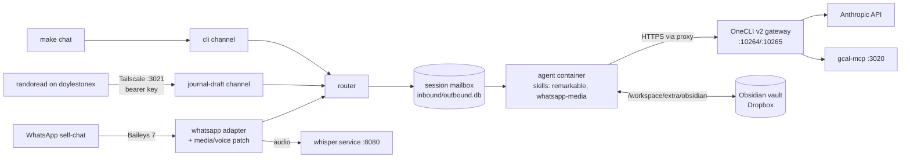

# jonwhittlestone/nanoclaw: fork notes

A personal fork of [nanocoai/nanoclaw](https://github.com/nanocoai/nanoclaw) v2, running as
**oh-two** on doylestone02. It's upstream `v2026.10.0`, plus the customisations ported from
the v1 fork (frozen at tag `v1-final`; reference copy in [`v1-fork-reference/`](v1-fork-reference/README.md)).
The full history, decisions and rollback plan live in the Obsidian design doc (`26-nanoclaw/main.md`, §06).

## What the fork adds

| Feature | Where | Notes |
|---|---|---|
| Google Calendar | `fork/config.json` → `mcpServers.google-calendar` | gcal-mcp is a host systemd service on `:3020` |
| reMarkable PDFs | `container/skills/remarkable/` | apt/npm packages + vault mount declared in `fork/config.json` |
| WhatsApp inbound media | `src/channels/whatsapp.ts` (`toInboundAttachment`) | patch: bytes inline so they land in the session inbox |
| Voice notes → text | `src/transcription.ts` + adapter | local whisper.cpp (`whisper.service`, `:8080`) |
| Media skill + 2-day inbox prune | `container/skills/whatsapp-media/`, `src/modules/inbox-prune/` | |
| randoread journal endpoint | `src/channels/journal-draft/` | v1-compatible HTTP contract on the Tailscale IP |
| Fork state as code | `fork/config.json`, `scripts/fork-apply.ts`, `scripts/fork-wire.sh` | re-applied after any (re-)migration |
| Side-by-side OneCLI 1.42 | `fork/onecli-v2/` | v2's gateway at `~/.onecli-v2` (API `:10264`, proxy `:10265`) |

## How it fits together



## Prerequisites and setup

Node 24, pnpm (corepack), Docker, ffmpeg, uv (for the fork's Python tests), the host services
`gcal-mcp.service` and `whisper.service`, and OneCLI v2 (`fork/onecli-v2/README.md`).

```bash
make setup          # pnpm + bun deps
make doctor         # toolchain, gateway, sidecars, service status
make image          # build the agent image
make fork-apply     # apply fork/config.json to the central DB
make fork-wire      # journal-draft group + wiring (host must be running)
```

After committing a customisation, stamp the reviewed checkout before restarting, or v2's
upgrade tripwire refuses to start: `pnpm exec tsx scripts/upgrade-state.ts set`.

## Testing

```bash
make test           # host vitest suite + fork Python tests
make check          # what CI runs: format, typecheck host + container, tests
make test-fork      # just the reMarkable converter tests
```

CI (`.github/workflows/ci.yml`) runs on PRs into `main` and `v2/**`, including a
`fork-python` job. Two upstream tests fail locally on doylestone02 only (they see the
real OneCLI install and a shared `/tmp` fixture): `setup/gateways/onecli-detection.test.ts`
and `src/group-skills.test.ts`.

## Makefile targets

`help`, `setup`, `doctor`, `build`, `image`, `test`, `test-host`, `test-container`,
`test-fork`, `check`, `run`, `chat`, `deploy`, `logs`, `status`, `fork-apply`, `fork-wire`,
`inspect-groups`, `inspect-wiring`, `inspect-tasks`. Run `make help` for descriptions.

## Cut-over and rollback

1. `scripts/fork-cutover-pre.sh`: checks, stops v1, takes a fresh backup, resets v2 state
2. in a real terminal: `bash migrate-v2.sh` (select WhatsApp; `/exit` when Claude opens)
3. `scripts/fork-cutover-post.sh`: fork state, service, wiring, automated checks, manual checklist

Rollback at any point: `scripts/fork-rollback.sh` (`--restore-keystore` if v1's WhatsApp
won't reconnect).

## Upgrading upstream

Use `/update-nanoclaw` on its own branch. The fork's touch points in upstream files are small:
`src/channels/index.ts` and `src/modules/index.ts` (one import each), `src/channels/whatsapp.ts`
(marked `Fork:`), `.github/workflows/ci.yml` (branches + `fork-python`), `.gitignore`,
`.env.example` and `Makefile`.
